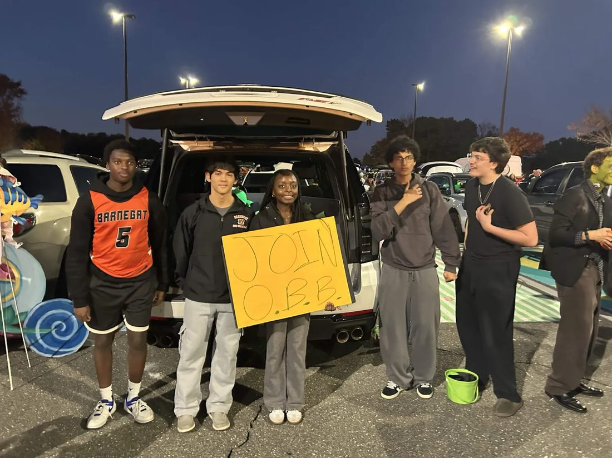

Our members made sure to spread the Halloween festivities through decorating an OBB car and handing out candy to the young coming to BHS's Trunk or Treat event. The car was modelled to be a forest, based off of our section of the Pinelands, haunted by litter monsters terrorizing the natural scenery. This was to show the effects of plaguing the nature of litter and how even one piece can cause terrible effects. To all the children who got to experience the night and our candy, Happy Halloween!

